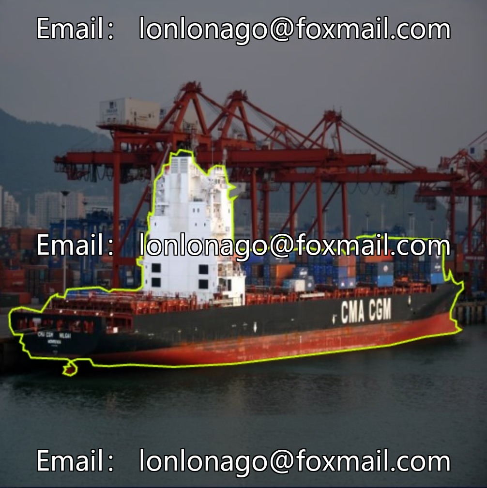
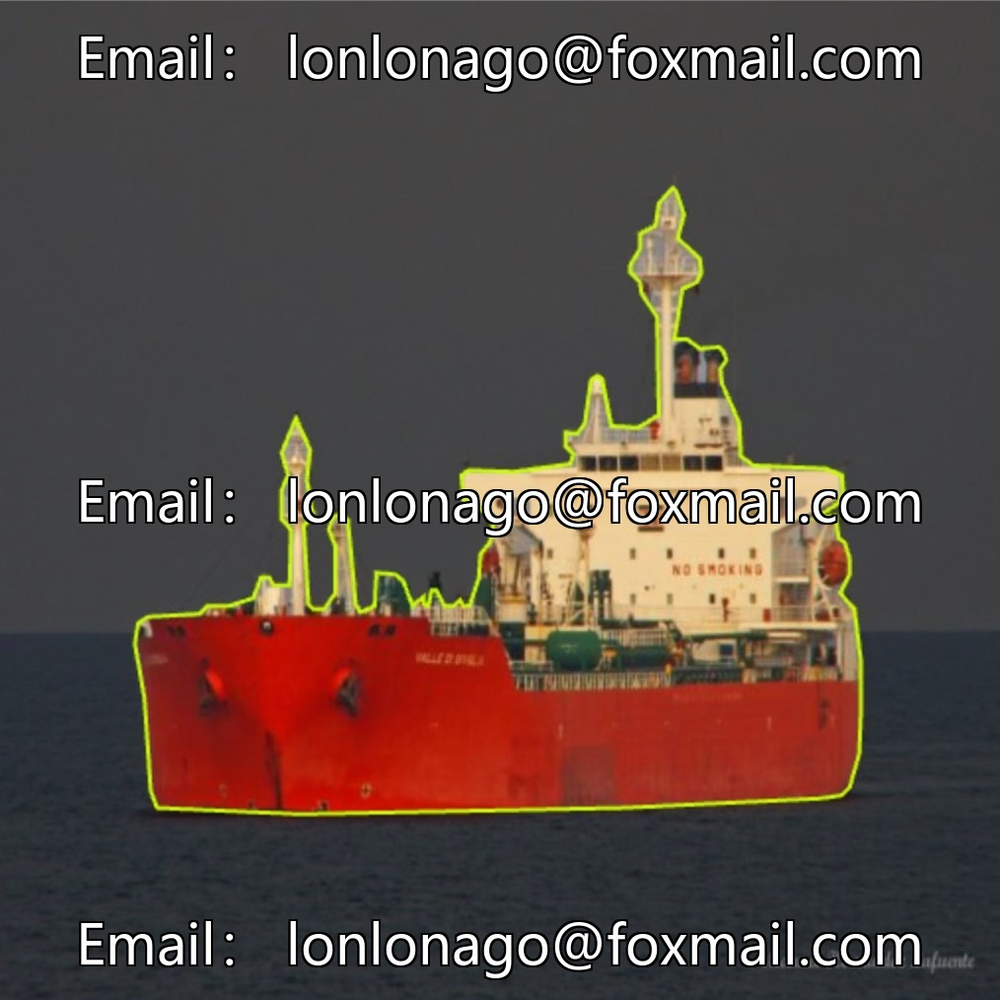
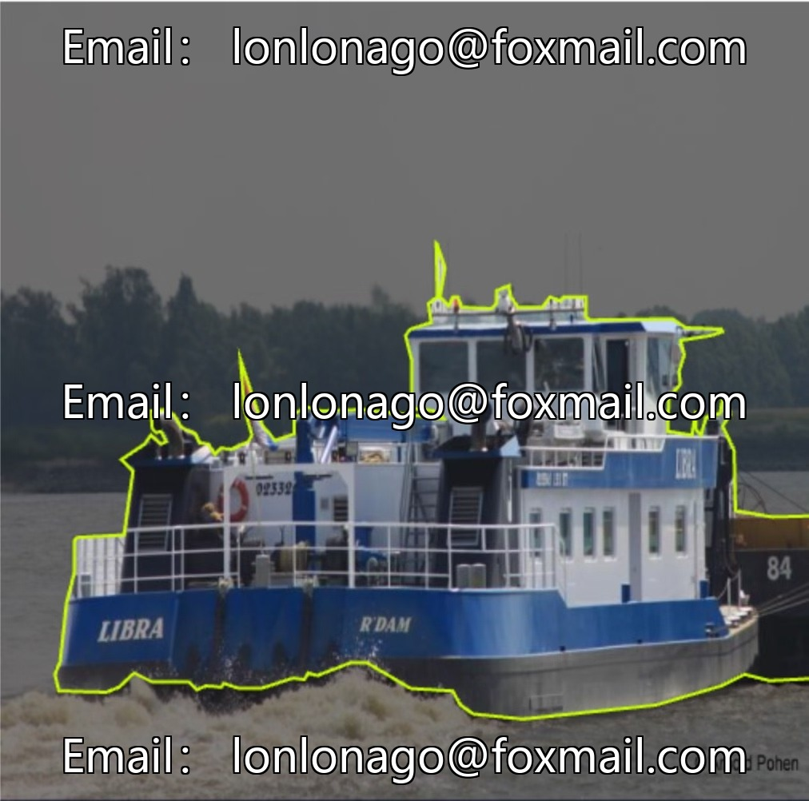
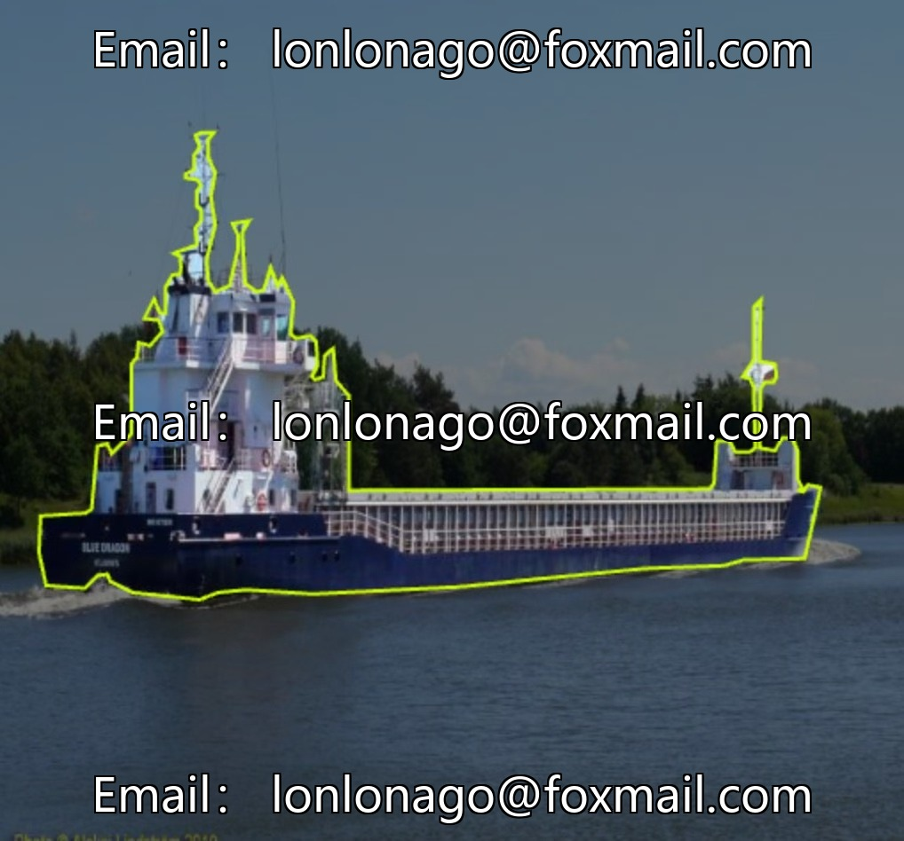
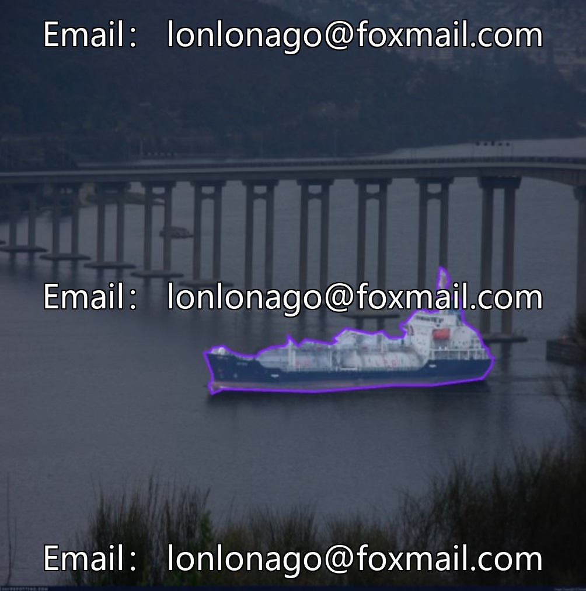

# Intelligent Maritime Vessel Identification, River-Based Cargo Ship Identification, and Container Ship Image Segmentation Dataset, including

## Body

Intelligent Maritime Vessel Identification, River-Based Cargo Ship Identification, Container Cargo Ship Image Segmentation Dataset, Computer Vision Field Instance Segmentation Dataset, Issue No. 10241

Data Quantity: 1152 images (approximately 1200), image files format, with accompanying BibTeX citation template
Application Scenarios: Training of instance segmentation algorithms, model validation, and adaptability for scenarios such as Construction, Manufacturing, Robotics, Self-Driving

The dataset is an instance segmentation type, supporting precise target segmentation, suitable for algorithm development and model training.
Format: Image files, reference template convenient for academic citations.

Virtual materials, once sold, are non-refundable.
Interested friends, click "I want" to proceed.

## Images

## Payment

Here is a pay link on Stripe ( https://buy.stripe.com/3cs8yP7sY87d0vu9AB ). Please contact me lonlonago@foxmail.com after funding $89, and I will send you a complete data files , thank you!

